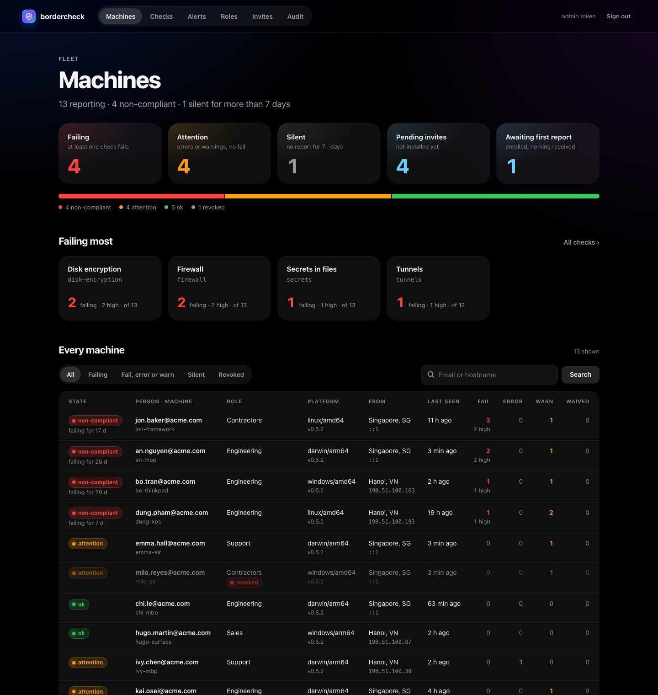
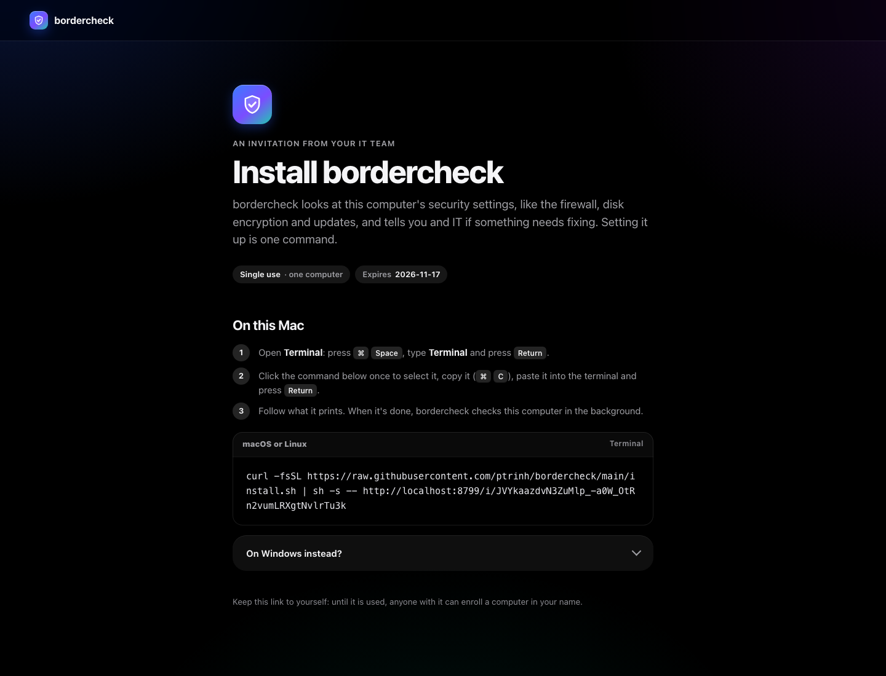
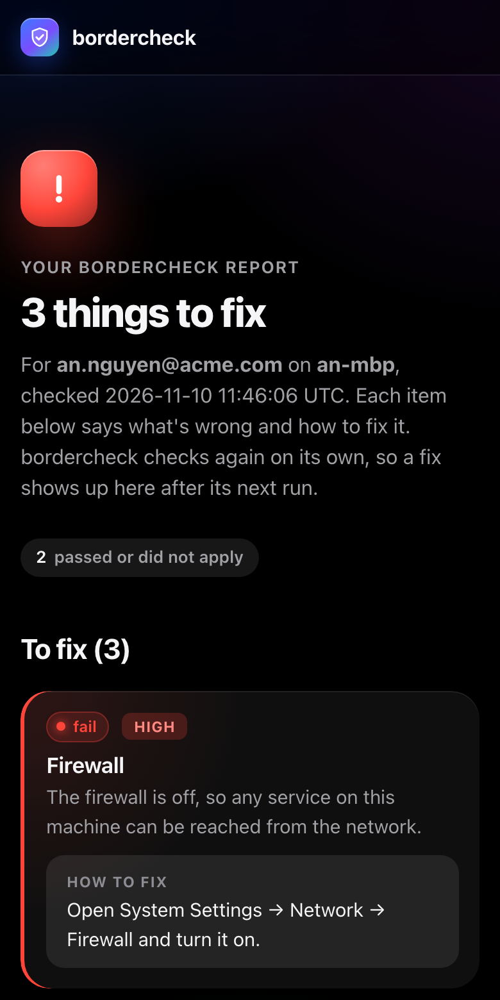

# bordercheck

**Finds the open doors on your work laptop and tells you how to close them.**

One stolen password or one bad download can let someone onto a laptop. How much damage they do next depends
on what was left open. bordercheck looks for:

- programs that accept connections from other machines
- API keys and passwords saved as plain text
- SSH keys with no passphrase
- tunnels, remote access and AI agents that skip approvals

For each one it finds, it says how to fix it. It runs on macOS, Windows and Linux and needs no admin rights.
A plain run only reads: it changes nothing and sends nothing.

It is not an antivirus. It does not catch malware; it limits what malware, or a person, can reach.

Companies can install it on every laptop, and each one then reports to the IT team on a schedule. See
[For organisations](#for-organisations).

<p align="center"></p>

## What it checks

| Check | |
|---|---|
| `firewall` | macOS Application Firewall and stealth mode; Windows Firewall on every profile; on both, an outbound firewall (LuLu on macOS, simplewall on Windows, suggested if missing); ufw, firewalld or nftables/iptables on Linux (live rules need `sudo`) |
| `disk-encryption` | FileVault, BitLocker, LUKS/dm-crypt or ZFS encryption |
| `listeners` | Ports reachable beyond localhost |
| `tailscale` | "Allow incoming connections" is off (shields up) |
| `docker` | Containers with ports on 0.0.0.0, host network, privileged, or mounts of `/`, home, credential folders or the Docker socket |
| `secrets` | Keys in shell files and history, `.env` files, private key files and a dozen credential stores (`~/.aws`, Docker, kubeconfig, `.netrc`, gcloud…) |
| `os-updates` | OS version against your minimum, automatic updates on, nothing left waiting; Chrome, Edge, Firefox, Brave not stale |
| `screen-lock` | A password after sleep, and the screen locks soon enough (Linux: GNOME and KDE only) |
| `remote-access` | SSH server, screen sharing, remote management, RDP and WinRM are off (a guest account is accepted unless the policy says otherwise) |
| `ssh-keys` | Private keys without a passphrase or readable by others; who can log in through `authorized_keys` |
| `tunnels` | ngrok, cloudflared, `tailscale funnel`/`serve`, VS Code tunnels, `ssh -R` and others |
| `ai-agents` | Plain-text tokens in MCP and agent configs, and settings that skip approvals or the sandbox |
| `cracked-software` | Traces of cracked Adobe, Autodesk, Windows or Office (blocked licensing servers, KMS emulators, KMSpico); suggests free alternatives |
| `admin-rights` | The daily account is not an administrator; no passwordless `sudo`; Windows UAC on and asking, built-in Administrator off |
| `os-protections` | SIP and Gatekeeper (macOS); Defender or another antivirus, tamper protection, SmartScreen, Secure Boot (Windows); Secure Boot, AppArmor or SELinux enforcing (Linux) |
| `sharing` | AirDrop for Everyone, File, Printer, Internet, Media and Bluetooth Sharing, Content Caching (macOS); shared folders, network discovery on public networks, Nearby sharing (Windows); Samba, NFS, CUPS and GNOME file sharing (Linux) |

`os-updates`, `screen-lock` and `remote-access` never go online: they judge what the machine already knows.
Details and options for each: [Policies](docs/policies.md#checks).

## Try it in 30 seconds

Download `bordercheck-<version>-<os>-<arch>` from [Releases](https://github.com/ptrinh/bordercheck/releases/latest)
and run it:

```sh
bordercheck                    # check and print a report
bordercheck -json              # the same report as JSON
bordercheck -only secrets,tailscale
bordercheck -list
```

Exit status: `0` no failures (waived ones do not count), `1` at least one failure, `2` error. A plain run only
reads: it changes nothing and sends nothing. `sudo bordercheck` also shows ports held by system services on
macOS. macOS binaries are signed and notarized; Windows binaries are not Authenticode-signed yet.

## For organisations

Each machine runs bordercheck every hour as a per-user service and reports to you. Two ways to set that up:

- **The portal** (recommended). Deploy [`receiver/`](receiver), a Cloudflare Worker, on your own account. Give
  each role (Dev, Support, Sales…) a policy, create an invite per person, and send them one command:

  ```sh
  curl -fsSL https://raw.githubusercontent.com/ptrinh/bordercheck/main/install.sh | sh -s -- https://bordercheck.acme.com/i/<code>
  ```

  Each machine gets its own token, so you can revoke one alone. The portal shows the fleet, posts alerts to
  Discord or Slack, and can be driven by Claude through its MCP server.
- **A static `policies.json`**, with no portal: host one policy file and your own report endpoint, or keep the
  file beside the binary and only run it by hand.

<p align="center">


</p>

Above: the invite an employee opens, and the report page a person sees for their own machine.

A policy only needs what it changes:

```json
{ "checks": { "listeners": { "on_problem": "fail" }, "tailscale": { "enabled": false } } }
```

## Privacy and security

- A plain run sends nothing. An installed copy sends a report to the one endpoint in its policy: pass/fail,
  severity, summary and fix per check, plus the email and install ID. Evidence (paths, ports, names) and the
  machine's own IP addresses are sent only if the policy asks. No location is sent.
- Secret values are never printed or sent; at most the last 4 characters of a long provider token.
- An enrolled machine's token goes only to the portal that issued it.
- Updates install only releases whose checksums are signed with the release key, and the update source is
  pinned at install: whoever controls the policy cannot push a binary.
- Reports are self-reported: they tell you who needs help, not proof of compliance.

## Guides

- [Installing bordercheck on laptops](docs/install.md): invite links, a static `policies.json`, the service,
  notifications, updates, uninstall, what is stored and sent, what the install script proves.
- [Running your own portal](docs/portal.md): deploy, sign in, roles, invites, alerts, custom domain, MCP,
  upgrading.
- [Policies](docs/policies.md): every field and every check's options, waivers, notifications, examples.
- [`receiver/README.md`](receiver/README.md): the portal's full reference: wire contract, schema, security
  model, settings.

Not yet: Homebrew and winget packages, Authenticode-signed Windows binaries, outdated-package checks (Homebrew,
npm, pip).

## Build

```sh
go test ./...
scripts/build-all.sh v0.2.0      # dist/ for macOS, Linux and Windows, arm64 and amd64, plus SHA256SUMS
```

## Contributing and licence

How to build, test, add a check and make a release: [CONTRIBUTING.md](CONTRIBUTING.md). MIT licence
([LICENSE](LICENSE)).
