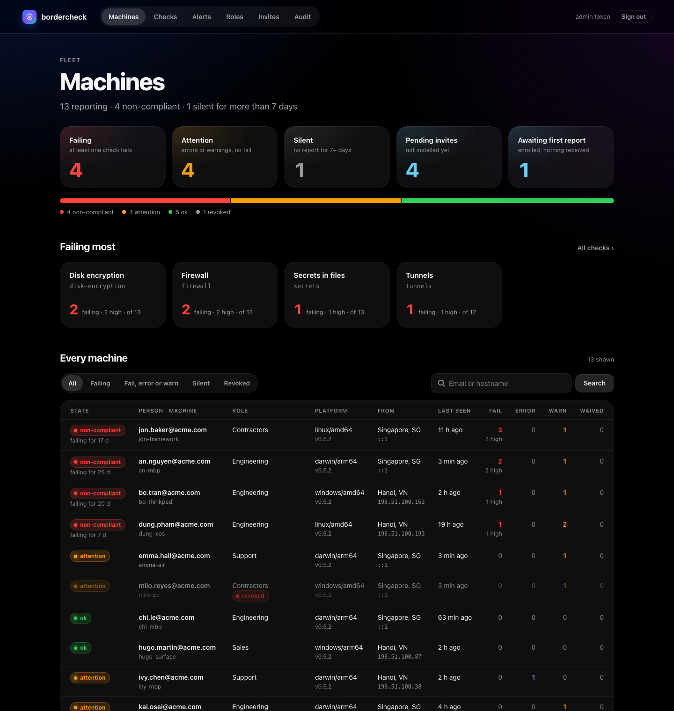
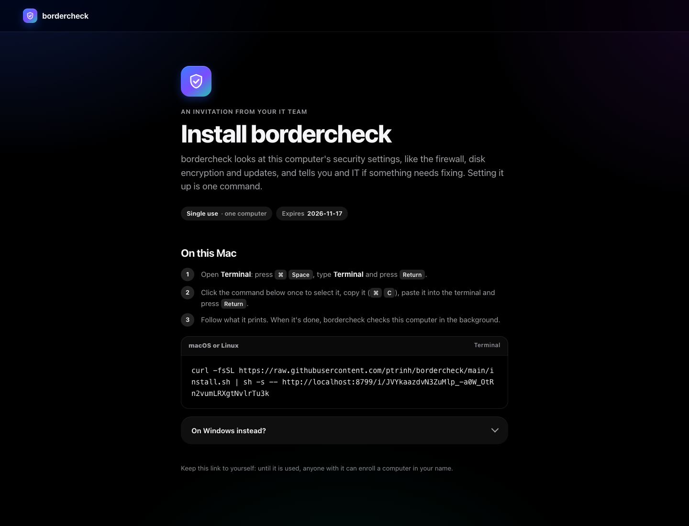
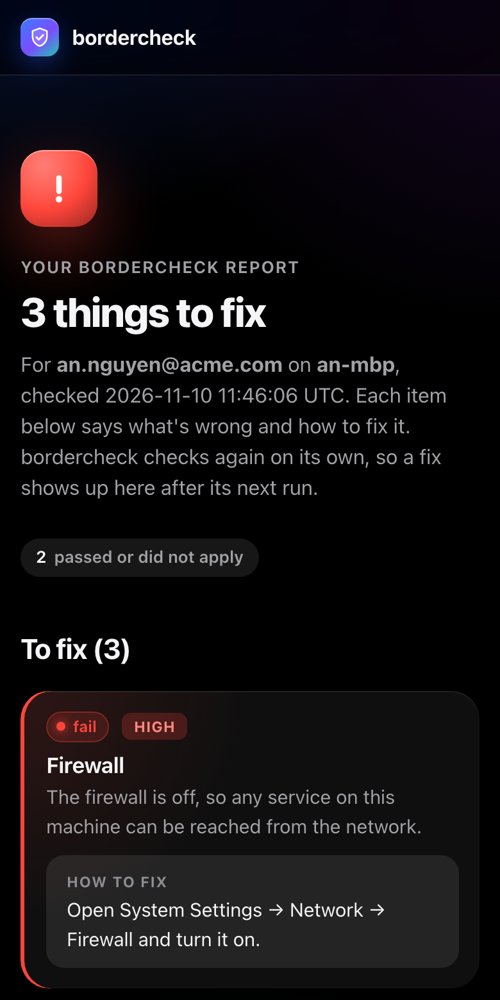

# BorderCheck

**Finds the open doors on your work laptop and tells you how to close them.**

One stolen password or one bad download can let someone onto a laptop. How much damage they do next depends
on what was left open. BorderCheck looks for:

- programs that accept connections from other machines
- API keys and passwords saved as plain text
- SSH keys with no passphrase
- tunnels, remote access and AI agents that skip approvals

For each one it finds, it says how to fix it, step by step, so you can fix it yourself or hand it to an AI coding
assistant: `bordercheck fix` prints the findings as instructions for Claude Code, ChatGPT Codex or the like, and
an installed copy's report page offers the same as a prompt to copy. It runs on macOS, Windows and Linux and needs
no admin rights.
A plain run only reads: it changes nothing and sends nothing.

It is small and fast. BorderCheck is one file of about 8 MB with nothing else to install, and a full check takes
less than a second on an Apple M5 MacBook. An installed copy does not stay running in the background: the system
starts it once an hour, it does its work and exits.

It is not an antivirus. It does not catch malware; it limits what malware, or a person, can reach. A few of its
findings are strong signs that something hostile is already installed (a startup item that downloads and runs
code, an extension IT has blocked, a crack tool, a Defender exclusion of a whole drive, a hosts file that
sends a bank's site elsewhere); when it sees one it says so first and, when installed, tells IT
at once ([signs of compromise](docs/policies.md#signs-of-compromise)).

> **For organisations:** every laptop reports to a management portal you host yourself (fleet, roles, invites,
> alerts), and access can depend on each laptop's results through Cloudflare Zero Trust and the Cloudflare One
> client (WARP). See [For organisations](#for-organisations) and the [Zero Trust guide](docs/zero-trust.md).

<p align="center"></p>

## What it checks

| Check | |
|---|---|
| `firewall` | macOS Application Firewall and stealth mode; Windows Firewall on every profile; on both, an outbound firewall (LuLu on macOS, simplewall on Windows, suggested if missing); ufw, firewalld or nftables/iptables on Linux (live rules need `sudo`) |
| `disk-encryption` | FileVault, BitLocker, LUKS/dm-crypt or ZFS encryption |
| `listeners` | Ports reachable beyond localhost |
| `mesh-vpn` | Private networks (Tailscale, ZeroTier, NetBird, WireGuard, Nebula, Hamachi) do not let their other members in: Tailscale shields up, NetBird "Block inbound connections", no inbound rules in Nebula; ZeroTier, WireGuard and Hamachi have no such switch, so a connected one is a warning |
| `docker` | Containers with ports on 0.0.0.0, host network, privileged, or mounts of `/`, home, credential folders or the Docker socket, in every local engine (Docker Desktop, OrbStack, Colima, Rancher Desktop, Podman…) |
| `secrets` | Keys in shell files and history, `.env` files, private key files, a dozen credential stores (`~/.aws`, Docker, kubeconfig, `.netrc`, gcloud…) and, for information, the last 48 hours of AI assistants' chat history (Claude Code, Codex, Gemini CLI, Copilot, Cursor's agent, Cline, Aider; `bordercheck full-scan` reads all of it, and git history and logs) |
| `os-updates` | OS version against your minimum, automatic updates on, nothing left waiting; Chrome, Edge, Firefox, Brave not stale |
| `screen-lock` | A password after sleep, and the screen locks soon enough (Linux: GNOME and KDE only) |
| `remote-access` | SSH server, screen sharing, remote management, RDP and WinRM are off (a guest account is accepted unless the policy says otherwise); remote-control apps (TeamViewer, AnyDesk, RustDesk, Chrome Remote Desktop, Splashtop, ScreenConnect, VNC servers) not running or starting by themselves, and not open to unattended access |
| `ssh-keys` | Private keys without a passphrase or readable by others; who can log in through `authorized_keys` |
| `tunnels` | ngrok, cloudflared, `tailscale funnel`/`serve`, VS Code tunnels, `ssh -R` and others |
| `ai-agents` | Plain-text tokens in MCP and agent configs, settings that skip approvals or the sandbox, and Claude Code / Codex global instructions without a secrets rule (touchenv) |
| `cracked-software` | Traces of cracked software: Windows and Office activators, licensing servers blocked in the hosts file or the firewall (Adobe, Autodesk, CorelDRAW, IDM, Camtasia, Bandicam, Filmora…). Fails only on crack tools that commonly carry malware (KMSpico, KMSAuto, AAct…); suggests free alternatives |
| `admin-rights` | No passwordless `sudo`; Windows UAC on and asking, built-in Administrator off; if the policy asks, that the daily account is not an administrator |
| `os-protections` | SIP and Gatekeeper (macOS); Defender or another antivirus, tamper protection, SmartScreen, Secure Boot (Windows); Secure Boot, AppArmor or SELinux enforcing (Linux) |
| `sharing` | AirDrop for Everyone, File, Printer, Internet, Media and Bluetooth Sharing, Content Caching (macOS); shared folders, network discovery on public networks, Nearby sharing (Windows); Samba, NFS, CUPS and GNOME file sharing (Linux) |
| `extensions` | Browser (Chrome, Edge, Brave, Firefox…) and VS Code-family editor extensions on your block list, outside your allow list, or loaded from outside a store |
| `browser-passwords` | Passwords saved in the browser's own password manager, which information stealers take first |
| `trust-store` | Root certificates added to the trust store, and a system proxy, PAC file or proxy variable |
| `package-managers` | npm, pnpm, Yarn, Bun, pip, uv, Go and Cargo settings: registries over plain http, certificate or checksum checks off, every package's install scripts allowed to run |
| `startup-items` | What starts at login or on a schedule (LaunchAgents, autostart, systemd user units, crontab, Run keys, scheduled tasks): download-and-run commands, programs in temporary, download or hidden folders, programs anyone can change; and what hides malware: broad Microsoft Defender exclusions, a hosts file that redirects sign-in or bank sites or blocks security vendors, unsigned programs running from temporary or download folders |
| `backup` | Time Machine encrypted (and, if the policy asks, set up and recent); Find My Mac or Find my device on |
| `warp` | Off unless the policy turns it on: the Cloudflare One client (WARP) installed, signed in to your Zero Trust team, connected, and if asked in Posture only mode ([Zero Trust guide](docs/zero-trust.md)) |

`os-updates`, `screen-lock` and `remote-access` never go online: they judge what the machine already knows.
Details and options for each: [Policies](docs/policies.md#checks).

## Try it in 30 seconds

Download `bordercheck-<version>-<os>-<arch>` from [Releases](https://github.com/ptrinh/bordercheck/releases/latest)
and run it:

```sh
bordercheck                    # check and print a report, with how to fix each finding
bordercheck fix                # the same as instructions for an AI coding assistant
bordercheck -json              # the same report as JSON
bordercheck -only secrets,mesh-vpn
bordercheck -list
```

A check marked **ℹ Info** found something worth knowing that is not a problem (an Android signing keystore, a key in [touchenv](https://github.com/ptrinh/touch-env) that looks highly
sensitive yet is synced through iCloud or can be granted from afar, a
cloud CLI's sign-in cache, keys in AI chat history): it keeps its status, never counts as a problem or alerts,
and the portal can filter on it ("With info").

Exit status: `0` no failures (waived ones do not count), `1` at least one failure, `2` error. A plain run only
reads: it changes nothing and sends nothing. `sudo bordercheck` also shows ports held by system services on
macOS. macOS binaries are signed and notarized; Windows binaries are not Authenticode-signed yet.

## For organisations

Each machine runs BorderCheck every hour as a per-user service and reports to you. Two ways to set that up:

- **The portal** (recommended). Deploy [`receiver/`](receiver), a Cloudflare Worker, on your own account. Give
  each role (Dev, Support, Sales…) a policy, create an invite per person, and send them one command:

  ```sh
  curl -fsSL https://raw.githubusercontent.com/ptrinh/bordercheck/main/install.sh | sh -s -- https://bordercheck.domain.com/i/<code>
  ```

  Each machine gets its own token, so you can revoke one alone. The portal shows the fleet, posts alerts to
  Discord or Slack, can be driven by Claude through its MCP server, and can gate access: with Cloudflare Zero
  Trust, a machine that fails for too long or shows signs of compromise loses access
  ([Zero Trust guide](docs/zero-trust.md)).
- **A static `policies.json`**, with no portal: host one policy file and your own report endpoint, or keep the
  file beside the binary and only run it by hand.

<p align="center">


</p>

Above: the invite an employee opens, and the report page a person sees for their own machine.

A policy only needs what it changes:

```json
{ "checks": { "listeners": { "on_problem": "fail" }, "mesh-vpn": { "enabled": false } } }
```

## Privacy and security

- A plain run sends nothing. An installed copy sends a report to the one endpoint in its policy: pass/fail,
  severity, summary and fix per check, plus the email and install ID. Evidence (paths, ports, names) and the
  machine's own IP addresses are sent only if the policy asks; so is the device's location (`include_location`, off by
  default).
- Secret values are never printed or sent; at most the last 4 characters of a long provider token.
- An enrolled machine's token goes only to the portal that issued it.
- Updates install only releases whose checksums are signed with the release key, and the update source is
  pinned at install: whoever controls the policy cannot push a binary.
- Reports are self-reported: they tell you who needs help, not proof of compliance.

## FAQ

**Does BorderCheck have a GUI?**

No app window, on purpose. The only pages are web pages: the report page each person opens for their own
machine, and the portal, once you set one up. Desktop notifications tell people when something needs fixing.
Everything else is done from the command line or by an AI agent: an agentic UI is the new UI.

- On a laptop, `bordercheck` prints what it found, and `bordercheck fix` prints it as instructions for Claude Code,
  ChatGPT Codex or a similar assistant to work through with the person, asking before every change. The report
  page offers that prompt with a Copy button.
- For admins, the portal's [MCP server](receiver/README.md#mcp-server-ask-claude-about-the-fleet) lets Claude
  read the fleet and manage roles, invites, machines and waivers; scripts use the JSON API.

## Guides

- [Installing BorderCheck on laptops](docs/install.md): invite links, a static `policies.json`, the service,
  notifications, updates, uninstall, what is stored and sent, what the install script proves.
- [Running your own portal](docs/portal.md): deploy, sign in, roles, invites, alerts, custom domain, MCP,
  upgrading.
- [Policies](docs/policies.md): every field and every check's options, waivers, notifications, examples.
- [Enforcing with Cloudflare Zero Trust](docs/zero-trust.md): device posture from BorderCheck in Access
  policies, phones, grace periods, rolling it out.
- [`receiver/README.md`](receiver/README.md): the portal's full reference: wire contract, schema, security
  model, settings.

Not yet: Homebrew and winget packages, Authenticode-signed Windows binaries, outdated-package checks (Homebrew,
npm, pip).

## Build

```sh
go test ./...
scripts/build-all.sh v0.2.0      # dist/ for macOS, Linux and Windows, arm64 and amd64, plus SHA256SUMS
```

## Contributing and licence

How to build, test, add a check and make a release: [CONTRIBUTING.md](CONTRIBUTING.md). MIT licence
([LICENSE](LICENSE)).
