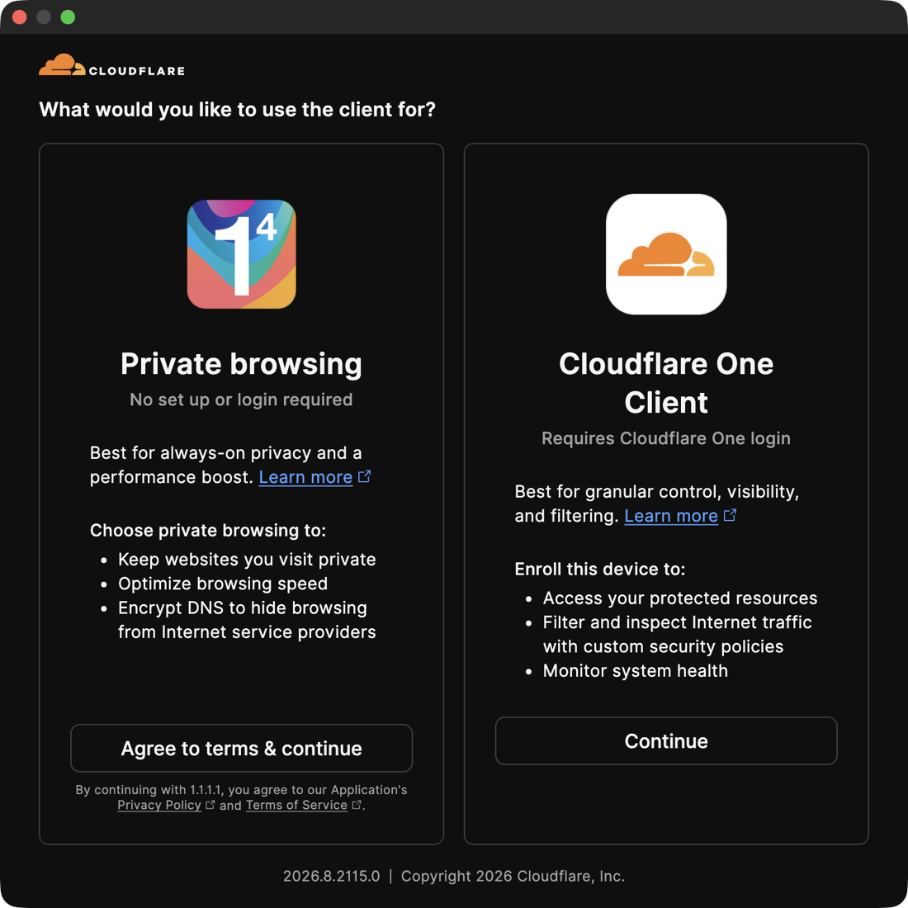
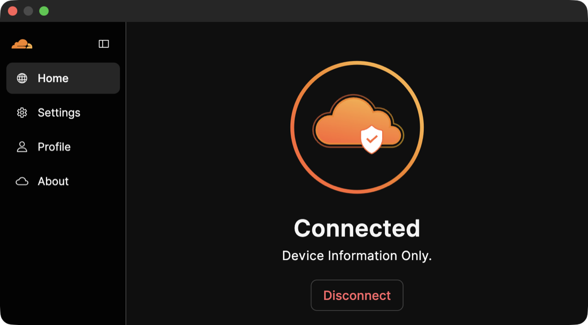

# Setting up the Cloudflare One client (WARP)

Your organisation lets computers into some of its apps only when Cloudflare Zero Trust can tell they are kept
safe. That takes the Cloudflare One client (WARP) on your computer, signed in to your organisation's team.
BorderCheck's `warp` check tells you what is missing and the team name to use.

In the mode your organisation uses (**Posture only**, shown as *Device Information Only*), the client only tells
Cloudflare which computer this is: it does not route your traffic, change your DNS or see what you browse.

An AI coding assistant (Claude Code, Codex…) can do most of this with you: see [For an AI assistant](#for-an-ai-assistant).

## 1. Install the client

| | |
|---|---|
| macOS | `brew install --cask cloudflare-warp`, or the installer from <https://one.one.one.one/> |
| Windows | `winget install Cloudflare.Warp`, or the installer from <https://one.one.one.one/> |
| Linux | the `cloudflare-warp` package: <https://pkg.cloudflareclient.com/> has the steps for each distribution |

Installing asks for your computer's administrator password.

## 2. Choose Cloudflare One Client

Open **Cloudflare WARP** (Applications on a Mac, the Start menu on Windows). On its first screen, choose
**Cloudflare One Client → Continue**, not *Private browsing*: Private browsing is the free consumer WARP and does
not count.

## 3. Enter the team name and sign in

Enter the **team name** BorderCheck gave you, then sign in, in the browser window that opens, with the **same
email your BorderCheck invite was sent to**. Another email and Cloudflare cannot match this computer to your
BorderCheck report.

## 4. Check that it is connected

The window shows **Connected · Device Information Only**:

If it shows **Disconnected**, choose **Connect**. Leave it connected: Zero Trust cannot check the computer while
it is off. Then run BorderCheck again (or wait for its next check): the `warp` check passes.

## If something is wrong

| BorderCheck says | What to do |
|---|---|
| Not installed | Step 1. |
| Installed, but its service did not answer | Open Cloudflare WARP once; if it still does not answer, restart the computer. |
| Not signed in, or signed in as the free consumer WARP | Steps 2–3. If you chose Private browsing before: `warp-cli registration new <team>` |
| Signed in to another team | `warp-cli registration delete`, then `warp-cli registration new <team>` |
| Disconnected | Step 4, or `warp-cli connect` |
| On but not connected, *Failed to set mTLS Identity* or another certificate error | A setting of your organisation, not of your computer: tell IT what it says. |
| Runs in another mode, not Posture only | Set by your organisation's device profile: tell IT. |

## For an AI assistant

Run the commands one at a time, and ask the person before each one that changes something.

1. Install (step 1). The installer asks for an administrator password: the person types it.
2. `warp-cli registration new <team>`, with the team name from `bordercheck fix`. It may ask the person to accept
   Cloudflare's terms (theirs to accept, not yours) and opens a browser: the person signs in there with the email
   their BorderCheck invite was sent to.
3. `warp-cli connect`
4. Check: `warp-cli status` says `Connected`; `warp-cli registration show` says `Account type: Team` and the
   team as `Organization`. Do not paste the device or account IDs it prints anywhere.
5. Run `bordercheck fix` again: the `warp` finding is gone.

Do not change the client's mode or settings: the organisation sets them.
